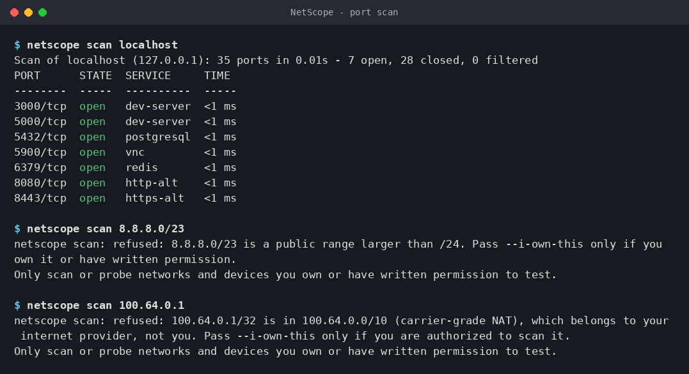
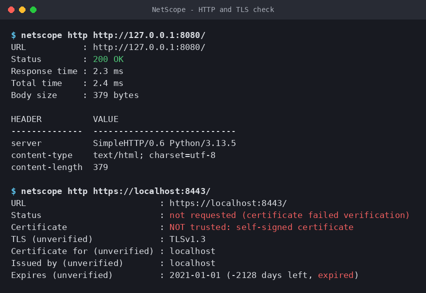
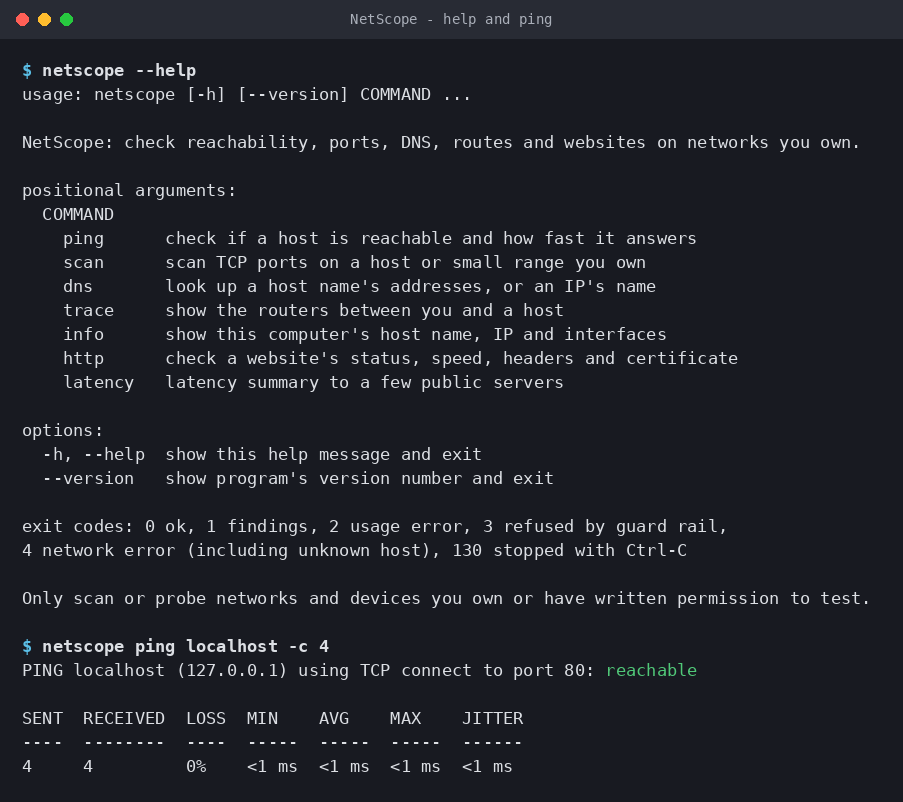

<p align="left">
  
</p>

# NetScope


A command-line network toolkit for checking **your own** machines and networks: is a host up, which
ports are open, what does a name resolve to, which routers are in the way, and is a website healthy
(including when its TLS certificate expires).

It runs on Windows, macOS and Linux, has **no required dependencies** (standard library only), and
never needs administrator rights.



## Features

| Command | What it does |
|---|---|
| `netscope ping HOST` | Reachability and latency (min / avg / max / jitter, packet loss). Uses the system `ping`, and falls back to timing TCP connections when ICMP isn't available. |
| `netscope scan TARGET` | Threaded TCP port scanner: open / closed / filtered, service names, per-port timing. Takes a host, an IP or a small CIDR range. |
| `netscope dns NAME` | Forward lookup (A and AAAA records), or a reverse (PTR) lookup when given an IP. |
| `netscope trace HOST` | The routers ("hops") between you and a host, using the system `tracert` / `traceroute` / `tracepath`. |
| `netscope info` | Host name, local IP address and network interfaces. |
| `netscope http URL` | Status code, response time, redirects, key headers, TLS version and certificate expiry. |
| `netscope latency` | Quick latency summary to Cloudflare, Google DNS and Quad9, with a rating. |

Every command supports:

- `--json` to print machine-readable JSON (with a `schema_version` field) instead of a table
- `--save report.json` or `--save report.html` to write a report file. The folder must already
  exist, and an existing file is only replaced if you add `--force`
- `--help` for its options and examples

Colour is used when printing to a terminal and switched off when piping or when `NO_COLOR` is set.

## Install

Requires Python 3.10 or newer.

```bash
git clone https://github.com/Alameen-26/NetScope.git
cd NetScope
python -m venv .venv
# Windows: .venv\Scripts\activate    macOS/Linux: source .venv/bin/activate
pip install -e .            # core tool, no dependencies
pip install -e ".[full]"    # adds psutil for the interface list in `netscope info`
pip install -e ".[dev]"     # adds pytest, mypy and pyflakes for running the checks
```

You can then run `netscope ...` or `python -m netscope ...`.

## Usage

```text
$ netscope scan localhost
Scan of localhost (127.0.0.1): 35 ports in 0.01s - 6 open, 29 closed, 0 filtered
PORT      STATE  SERVICE     TIME
--------  -----  ----------  ------
3000/tcp  open   dev-server  <1 ms
5000/tcp  open   dev-server  <1 ms
5432/tcp  open   postgresql  <1 ms
5900/tcp  open   vnc         <1 ms
6379/tcp  open   redis       <1 ms
8080/tcp  open   http-alt    <1 ms
```

```text
$ netscope scan 192.168.1.0/28 --ports 22,80,443,8000-8100 --timeout 1
$ netscope scan localhost --ports all --workers 50 --save scan.html
```

Times under one millisecond are shown as `<1 ms` (and stored as `0.5` in JSON). The default
`--timeout` per port is 0.5 s, or **3 s on Windows**, because Windows retries a refused connection
and only reports it after about 2 seconds; a shorter timeout there would mark closed ports as filtered.

One scan is capped at **65,536 connection attempts** (addresses x ports), so
`scan 192.168.1.0/24 --ports all` is refused until you narrow it or raise the cap with
`--max-probes`. If the computer runs out of open files (each port being checked holds one), the
scan retries those ports with fewer workers instead of reporting them as filtered, and prints a note.

```text
$ netscope ping localhost -c 3
PING localhost using TCP connect to port 80: reachable

SENT  RECEIVED  LOSS  MIN    AVG    MAX     JITTER
----  --------  ----  -----  -----  ------  ------
3     3         0%    <1 ms  <1 ms  1.1 ms  <1 ms
```

(A "connection refused" answer still proves the host is up, so the TCP fallback counts it as a reply.)

```text
$ netscope http http://127.0.0.1:8080/
URL           : http://127.0.0.1:8080/
Status        : 200 OK
Response time : 5.0 ms
Total time    : 5.0 ms
Body size     : 18511 bytes

HEADER          VALUE
--------------  ----------------------------
server          SimpleHTTP/0.6 Python/3.13.5
content-type    text/html; charset=utf-8
content-length  18511
```

For an `https://` URL the output also shows the TLS version, who the certificate was issued to and
by, the expiry date and the days left (marked **warning** at 30 days or fewer, **critical** at 7).

If the certificate fails verification (expired, self-signed, wrong name), no HTTP request is sent.
NetScope reports `Certificate : NOT trusted: certificate has expired` (or OpenSSL's reason) and exits
with 1. To show *which* certificate the server sent, it then does one more TLS handshake with
checking switched off, reads the certificate and hangs up; those lines are labelled `(unverified)`.

Redirects are only followed to `http://` and `https://` URLs with a valid host and port, each hop
gets its own certificate check, and a redirect from HTTPS down to plain HTTP is reported as a
finding. `--timeout` limits each network wait; `--deadline` (default 3 x timeout) limits the whole
check, redirects included.

```text
$ netscope scan 8.8.8.0/23
netscope scan: refused: 8.8.8.0/23 is a public range larger than /24. Pass --i-own-this only if you own it or have written permission.
Only scan or probe networks and devices you own or have written permission to test.
```

JSON output wraps every result in the same envelope:

```text
$ netscope scan localhost -p 8080 --json
{
  "schema_version": "1.0",
  "tool": "netscope",
  "version": "0.1.0",
  "command": "scan",
  "generated_at": "2026-10-29T13:47:58+00:00",
  "data": {
    "target": "localhost",
    "kind": "loopback",
    "ports_per_host": 1,
    "hosts": [
      {
        "host": "localhost",
        "ip": "127.0.0.1",
        "ports_scanned": 1,
        "duration_s": 0.001,
        "counts": { "open": 1, "closed": 0, "filtered": 0 },
        "ports": [
          { "port": 8080, "state": "open", "service": "http-alt", "latency_ms": 0.06 }
        ]
      }
    ]
  }
}
```

### Exit codes

Useful in scripts and CI jobs:

| Code | Meaning |
|---|---|
| 0 | OK |
| 1 | Findings: host unreachable or some pings lost, every trace hop silent (`*`), HTTP 4xx/5xx, certificate not trusted, expired or critical, HTTPS-to-HTTP redirect, unsafe redirect not followed, no PTR name for an IP in `dns` |
| 2 | Usage error: bad arguments (for example `--timeout nan`, `--port 0`, `--max-hops 65`), bad host name or port list, unusable `--save` path |
| 3 | Refused by a guard rail (see [Responsible use](#responsible-use)), including the `--max-probes` cap |
| 4 | Network error: unknown host (in every command), couldn't connect, a needed system tool isn't installed, or an unexpected error (shown as one line) |
| 130 | Stopped with Ctrl-C |

If `--save` fails (for example the disk is full) NetScope prints a warning and keeps the exit code
of the check itself. The report is written before the result is printed.

### Screenshots

| HTTP and TLS check | Help and ping |
|---|---|
|  |  |

## How it works

- **Port scan.** For each port, NetScope opens a TCP socket and calls `connect_ex()` with a timeout.
  A completed handshake means **open**; an immediate reset ("connection refused") means **closed**;
  no answer before the timeout means **filtered** (usually a firewall dropping packets). Ports are
  checked by a `ThreadPoolExecutor` (100 workers by default, at most 500), because each check spends
  almost all its time *waiting* on the network, and threads are fine for waiting work in Python.
- **Ping.** Sending ICMP directly needs raw sockets and admin rights, so NetScope runs the operating
  system's own `ping` (which is allowed to send ICMP) and parses its output. The host name is checked
  (letters, digits and `. : % _ -` only, never starting with `-`) and resolved first, and only the IP
  address is passed to `ping`. The parser doesn't depend on the words: a line is a reply if it has
  `TTL=` (or `hlim=` from macOS `ping6`), or exactly one time value (Windows IPv6 replies have no TTL).
  Supported and tested: English (`time=`), French (`temps=`), German (`Zeit=`) and Russian (`время=`,
  unit `мс`) output, `<1ms`, and decimal commas (`12,3 ms`). Other languages work if they use
  `TTL=` and `ms`. On Windows the output is decoded with the console's own code page (for example
  cp850), never guessed. Duplicate replies (`DUP!`) are counted separately so they can't hide lost
  packets. macOS uses `ping6` for IPv6. If `ping` isn't installed or ICMP is blocked, it times TCP
  connections instead.
- **DNS.** Uses the operating system's resolver through `socket.getaddrinfo()` (so it respects your
  hosts file and DNS settings) and `socket.gethostbyaddr()` for reverse lookups.
- **Traceroute.** Also runs the system tool (`tracert` on Windows, `traceroute` or `tracepath`
  elsewhere, `traceroute6` for IPv6 on macOS) and parses each hop's address and round-trip times.
  When several routers answer for one hop (macOS prints them on extra lines), the others are kept
  and shown as `(also ...)`.
- **Local info.** The local IP is found by "connecting" a UDP socket to a documentation-only address:
  no packet is sent, but the OS picks the network interface it *would* use and reports its address.
- **HTTP check.** Uses `http.client` and `ssl` from the standard library, follows up to five
  redirects, reads at most 2 MB of the body, and reads the peer certificate's `notAfter` date to work
  out how many days are left.
- **Guard rails.** Before any packet is sent, the scan target is classified with Python's
  `ipaddress` module:
  - loopback (`127.0.0.0/8`), private (`10/8`, `172.16/12`, `192.168/16`) and link-local ranges are allowed;
  - a single public host is allowed, with a reminder on stderr;
  - carrier-grade NAT (`100.64.0.0/10`, your ISP's shared space) and public ranges larger than /24
    are refused with exit code 3 unless you pass `--i-own-this`, which prints the responsible-use line;
  - any range over 1,024 addresses is refused, even with the flag. The size is checked before the
    range is turned into a list of addresses, so `10.0.0.0/8` or `::/64` is refused instantly;
  - IPv6 forms of IPv4 addresses (`::ffff:1.2.3.4`, NAT64 `64:ff9b::1.2.3.4`, 6to4 `2002::/16`)
    are judged by the IPv4 address inside them, so they can't be used to get around these rules.

## Architecture

```text
netscope/
├── __main__.py   # argparse CLI: one sub-command per feature, output, exit codes
├── safety.py     # guard rails: classify targets, decide whether a scan is allowed
├── hosts.py      # host name checks and a single DNS lookup shared by all commands
├── syscmd.py     # runs ping/tracert and decodes their output (Windows code pages)
├── x509.py       # reads names and dates from a certificate that failed verification
├── ping.py       # system ping + language-neutral parser, TCP fallback, statistics
├── portscan.py   # port list parsing, service names, threaded TCP connect scan
├── dns.py        # forward and reverse lookups
├── trace.py      # system traceroute wrapper and parser
├── netinfo.py    # host name, local IP, interfaces (psutil optional)
├── httpcheck.py  # HTTP(S) request, redirects, headers, TLS certificate expiry
├── latency.py    # latency summary to well-known public servers
├── output.py     # tables, colour, JSON envelope with schema_version
└── report.py     # --save: JSON or self-contained HTML report
tests/            # pytest suite (no internet needed)
docs/             # interview notes, roadmap, screenshots, brand assets
```

Each feature module returns a small **dataclass** (`PingResult`, `ScanResult`, `HttpResult`, ...) with a
`to_dict()` method, and knows nothing about printing. `__main__.py` turns those results into tables,
JSON or reports. Keeping the network logic separate from the output makes each part easy to test.

## Testing

```bash
pip install -e ".[dev]"
python -m pytest
```

The suite (389 tests) runs in about 15 seconds and **never touches the internet**: a fixture in
`tests/conftest.py` makes any connection or DNS lookup to something other than this machine fail the
test, even if the code under test catches the error. Port scans and HTTP(S) checks run against real
servers started on `127.0.0.1` inside the tests (with test-only certificates, one of them expired).
`ping` and `traceroute` parsing is tested with sample output in the Windows, macOS and Linux formats
in English, French, German and Russian, including raw cp850 and cp866 bytes as the Windows tools
write them; Windows-only behaviour is mocked. GitHub Actions runs the suite, `mypy` and `pyflakes`
on Windows, macOS and Linux with Python 3.10 and 3.13, plus a full `scan 127.0.0.1 -p 1-1024` on
Windows.

## Responsible use

NetScope is built for checking networks and devices **you own or have written permission to test**: your own PC, your home network, a lab, or a system where the owner has given you written authorization (for example a signed scope for a class assignment or a security test).

- Do not scan, probe, or map networks, servers, or devices you do not own or are not authorized to test, including school, workplace, café, or ISP networks, unless you have explicit written permission.
- Keep scans small and slow. Use the default rate limits and only the ports and hosts you need.
- Large public address ranges are refused unless you pass `--i-own-this`. Only use that flag if it is true.
- Unauthorized scanning or access may be illegal and may violate your network's or ISP's terms of service. Depending on where you are, laws that may apply include:
  - **Canada:** Criminal Code, R.S.C. 1985, c. C-46, s. 342.1 (Unauthorized use of computer)
  - **United States:** Computer Fraud and Abuse Act, 18 U.S.C. § 1030
  - **United Kingdom:** Computer Misuse Act 1990 (for example s. 1, Unauthorised access to computer material)
- Your ISP, school, or employer may also prohibit scanning in its acceptable-use policy, even where the law does not.

If you are not sure whether you are allowed to scan something, don't.

## Disclaimer

NetScope is provided "as is", without warranty of any kind, express or implied. The author is not responsible for any misuse or for any damage, service disruption, or legal consequences resulting from its use. You alone are responsible for making sure your use complies with all applicable laws, regulations, and agreements. This section is general information, not legal advice.

## Roadmap

v0.2.0 plans include an asyncio scanner, rate limiting with presets, ping and traceroute without
admin rights, more TLS details, opt-in banner grabbing, local host discovery, IPv6, a diff mode and
saved profiles. See [docs/ROADMAP.md](docs/ROADMAP.md) for the full list, and
[CHANGELOG.md](CHANGELOG.md) for what's in each release.

## License

© 2026 NiyiSoft (Alameen-26). All rights reserved. Viewing permitted; no license is granted to copy, modify, or redistribute.

---

<sub>Made by NiyiSoft</sub>
